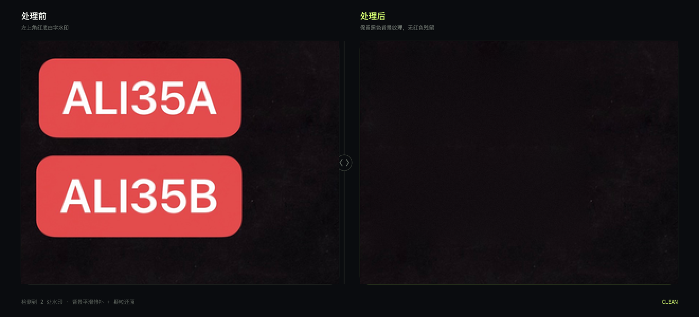

# 净印 · Monorepo

图片去水印工具的 monorepo：一个 TypeScript 图像库 + 一个 Electron 桌面应用。

- `packages/lib`：可独立安装的 npm 库，导出 `has`、`add`、`clean`
- `packages/app`：原有的 Electron 客户端，调用 lib 的 `clean` 清除水印




## 项目结构

```text
.
├── packages/
│   ├── lib/                 @cleanmark/lib
│   │   ├── src/
│   │   │   ├── index.ts     has / add / clean
│   │   │   ├── image.ts     sharp 编解码
│   │   │   ├── add.ts       绘制红底白字标签
│   │   │   ├── watermark.ts 检测与背景修补
│   │   │   └── types.ts     公开类型
│   │   ├── test/            真实图片 + 合成图片测试
│   │   ├── dist/            tsc 构建产物
│   │   └── package.json
│   └── app/                 @cleanmark/app
│       ├── src/
│       │   ├── main.js      Electron 主进程
│       │   ├── preload.js
│       │   ├── processor.js 调用 lib.clean 并批量写入
│       │   └── renderer/    HTML / CSS / JS
│       ├── scripts/         启动与 macOS/Windows 打包
│       └── assets/          应用图标
├── docs/                    截图
├── dist/                    最终应用产物
└── package.json             npm workspaces
```

## 环境要求

- Node.js 20+
- macOS 12+ 或 Windows 10/11 x64

## 快速开始

```bash
npm install
npm run build
npm test
```

`npm install` 会通过根目录的 `postinstall` 在 `packages/app/node_modules/@cleanmark` 下补一个指向 `packages/lib` 的链接，保证 app 在源码运行和单独打包时都能解析到 lib。

开发时启动 Electron：

```bash
npm run start:dev
```

如果 `dist/` 中已经存在打包后的 `.app`，`npm start` 会优先打开已打包应用；否则会回退到开发启动器。

> macOS 上若直接从终端执行 Electron 可执行文件遇到 `SIGTRAP`，开发启动器会通过 `open` 交给 LaunchServices 启动，属于已知系统兼容处理。

## lib API

```ts
import { has, add, clean } from '@cleanmark/lib';
import { readFile, writeFile } from 'node:fs/promises';

const input = await readFile('input.png');

await has(input);                 // boolean
await add(input, { labels: ['ALI35A', 'ALI35B'] }); // Buffer
const result = await clean(input); // { data, detected, watermarks, width, height, format }
await writeFile('output.png', result.data);
```

- `has(input, options?)`：检测左上角是否存在红底白字水印
- `add(input, options?)`：添加一个或多个红色圆角标签
- `clean(input, options?)`：清除水印；未检测到水印时原样返回输入 Buffer，不重新压缩
- `input` 支持文件路径、`Buffer`、`Uint8Array`
- 支持 JPEG、PNG、WebP、TIFF、AVIF

完整 API 见 [`packages/lib/README.md`](packages/lib/README.md)。

## app 功能

- 选择或拖入文件夹，批量处理图片
- 输出到同级的 `<文件夹名>-transformed`，保留子目录结构
- 调用 `@cleanmark/lib` 的 `clean`，检测红底、白字、黑色背景后做背景修补
- 深色 / 浅色主题切换，记忆上次选择，支持 `⌘/Ctrl + Shift + L`
- 处理前后对比滑块
- 没有检测到水印的图片原样复制
- 支持取消处理、打开输出文件夹
- 图片完全本地处理，不上传


## 主题切换

标题栏右上角的太阳 / 月亮按钮可切换深色 / 浅色主题。选择会写入用户数据目录的 `theme.json`，下次启动自动恢复。

## 使用

1. 打开应用，选择文件夹或拖入文件夹。
2. 确认文件列表与输出路径（`原文件夹名-transformed`）。
3. 点击「开始去除水印」。
4. 在右侧拖动对比滑块查看效果，点击输出卡片打开结果目录。

## 打包

```bash
npm run package       # macOS
npm run package:win   # Windows 10/11 x64
npm run package:all   # 同时构建两者
```

产物位于仓库根目录：

```text
dist/CleanMark-darwin-x64/CleanMark.app
dist/CleanMark-1.0.0-mac-x64.zip
dist/CleanMark-win32-x64/CleanMark.exe
dist/CleanMark-1.0.0-win-x64.zip
```

lib 的 npm 包可以通过 `npm pack -w @cleanmark/lib` 生成；当前工作区里也保留了一份 `dist/cleanmark-lib-1.0.0.tgz`。

- macOS 包未做 Apple Developer 签名/公证；如被 Gatekeeper 拦截，右键选择「打开」
- Windows 包为便携版，未做代码签名；SmartScreen 提示时选择「更多信息 → 仍要运行」
- Windows 版使用系统标题栏覆盖层，适配深色 / 浅色主题
- 在 macOS 上交叉打包 Windows 时，脚本会准备 Windows Electron 和 `@img/sharp-win32-x64`
- 打包 hooks 会移除 lib 自带的 `node_modules` 和非目标平台的 sharp 运行时，避免原生模块冲突与体积膨胀

## 识别与修补原理

1. 在图片左上角 52% × 34% 的区域搜索高饱和红色像素。
2. 对红色二值图膨胀后提取连通域，连接被白字分割的标签。
3. 结合宽高比、相对尺寸、红底密度、白字比例、外围黑色背景比例筛选标签。
4. 标签向外扩 5 px，覆盖圆角、抗锯齿和阴影。
5. 用外围背景做拉普拉斯调和插值，再叠加背景颗粒。
6. 按原格式输出；无水印时保留原始字节。

算法实现位于 [`packages/lib/src/watermark.ts`](packages/lib/src/watermark.ts)。app 的 [`processor.js`](packages/app/src/processor.js) 只负责文件扫描、调用 lib 和写入结果。

## 测试

```bash
npm test
```

覆盖：

- 两张真实示例图，每张识别 2 处水印，清除后无红色残留
- 无水印图片原样返回
- `add` 添加单/双标签后，`has` 能识别、`clean` 能清除
- JPEG 输入保持 JPEG 输出
- 负样本：超长红色横幅、压在非黑底商品上的标签不会被误判
- lib 构建与类型声明
- app integration：processor 通过 `@cleanmark/lib` 实际处理两张测试图

## 已知边界

- 只针对「左上角、红底白字、四周为黑色背景」的水印设计。
- 水印压在商品或复杂纹理上时，修补效果会下降。
- 不支持 HEIC、GIF 动图。
- 暂不递归处理符号链接目录。
