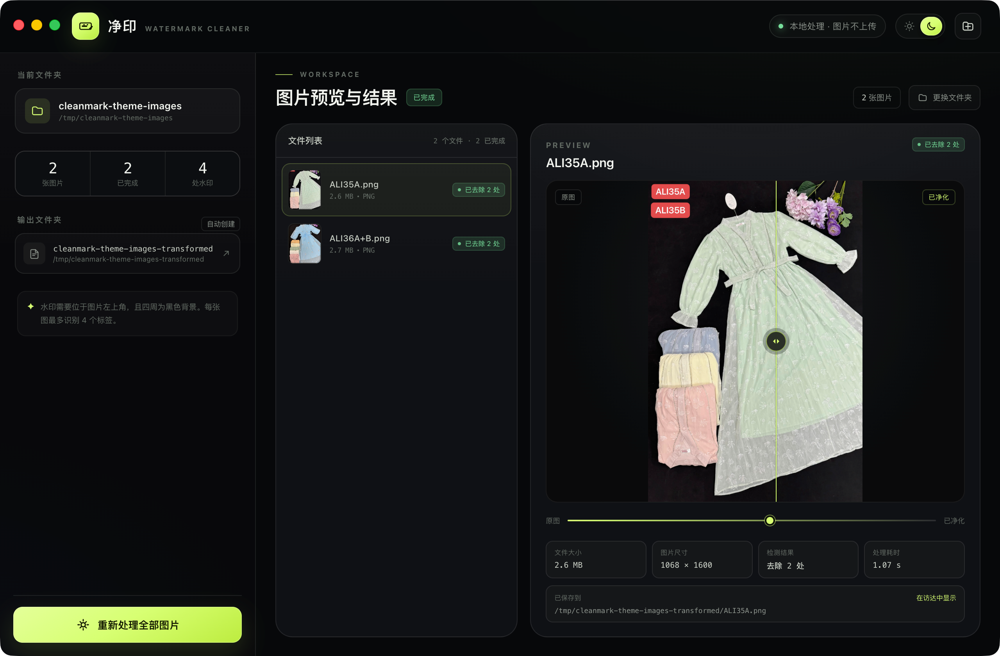
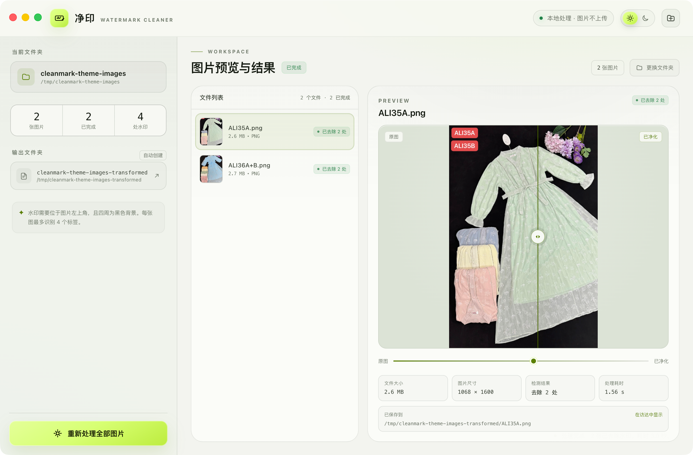

# 净印 · 图片去水印

一个基于 Electron 的桌面工具，用于批量清理商品图片左上角的「红底白字」水印。

水印通常紧贴黑色背景，工具会先识别红色标签，再用水印四周的真实背景做调和插值修补。处理后的图片保存到同级的 `<文件夹名>-transformed` 文件夹中，并保留子目录结构。




## 功能

- 选择或拖入文件夹，批量处理其中的 JPG / PNG / WebP / TIFF / AVIF 图片
- 自动识别左上角 1–2 个红色标签（最多兼容 4 个）
- 检测红底、白字，并校验标签周围是否为黑色背景，减少误判
- 完整覆盖抗锯齿边缘，用周围背景做拉普拉斯修补，再叠加背景颗粒
- 不需要联网，图片不会上传
- 深色 / 浅色主题切换，会记住上次选择，支持 `⌘/Ctrl + Shift + L`
- 处理结果与原图对比滑块
- 支持子文件夹，保持相对路径
- 默认保留原格式与画质（PNG/WebP 无损或高质量重编码，JPG 94 品质）
- 没有检测到水印的图片会原样复制到输出文件夹
- 支持取消处理、输出文件夹快捷打开

## 运行

环境要求：macOS 12+，或 Windows 10/11 x64；Node.js 20+。

```bash
npm install
npm start
```

如果已经执行过 `npm run package`，`npm start` 会直接打开 `dist` 里打包好的 `.app`。想修改源码后即时查看效果，使用：

```bash
npm run start:dev
```

开发启动器通过 `scripts/DevLauncher.app` 交给 LaunchServices 启动 Electron。这是因为在部分 macOS 版本中，从终端直接执行 `Electron.app/Contents/MacOS/Electron` 会触发 App Shim 的 `SIGTRAP`；经过 `open` 启动可以避开。

如果 Electron 下载失败，可以改用镜像重新安装：

```bash
ELECTRON_MIRROR="https://npmmirror.com/mirrors/electron/" npm install
```

## 打包 macOS 应用

```bash
npm run package
```

产物位于：

```
dist/CleanMark-darwin-x64/CleanMark.app
```

第一次打开时，macOS 可能会询问是否允许访问「文稿 / 桌面 / 下载」文件夹。请选择「允许」，否则读取文件夹会停住。也可以通过「系统设置 → 隐私与安全性 → 文件与文件夹」手动授予权限。

当前打包产物未做 Apple Developer 签名/公证。如果从网络下载后再打开被 Gatekeeper 拦截，可右键应用选择「打开」，或在「系统设置 → 隐私与安全性」中放行。

## 打包 Windows 11 应用

```bash
npm run package:win
```

产物：

```
dist/CleanMark-win32-x64/CleanMark.exe
dist/CleanMark-1.0.0-win-x64.zip
```

- 目标平台为 Windows 10/11 x64，便携版，不依赖安装器，解压后直接运行 `CleanMark.exe`
- 使用 Windows 原生标题栏覆盖层，适配深色 / 浅色主题和 Windows 11 窗口控制按钮
- 自动准备 `@img/sharp-win32-x64` 运行库；在 macOS 上交叉打包时会下载 Windows 版 Electron 和 sharp
- 当前 Windows 包未做代码签名，首次运行可能触发 SmartScreen：点「更多信息 → 仍要运行」即可
- 已验证 PE 文件、图标/版本资源和 asar 打包结构；建议在真实 Windows 11 上做最终启动验收

同时构建 macOS 和 Windows：

```bash
npm run package:all
```

## 主题切换

标题栏右上角有太阳 / 月亮切换按钮：

- 深色：默认主题，适合修图、暗色桌面环境
- 浅色：适合白天和浅色系统环境
- 选择会写入用户数据目录的 `theme.json`，下次启动自动恢复
- 快捷键：`⌘ + Shift + L`（Windows / Linux 为 `Ctrl + Shift + L`）



## 使用

1. 打开应用，点击「选择文件夹」，或将文件夹拖入窗口。
2. 确认文件列表和输出路径（自动生成为 `原文件夹名-transformed`）。
3. 点击「开始去除水印」。
4. 处理完成后，在右侧拖动对比滑块查看效果，点击输出卡片打开结果文件夹。

例如：

```
产品图/              →  产品图-transformed/
  ALI35A.png               ALI35A.png
  ALI36A+B.png             ALI36A+B.png
  子目录/A.png              子目录/A.png
```

## 识别与修补原理

1. 只在图片左上角 52% × 34% 的区域内搜索高饱和红色像素。
2. 对红色二值图做小半径膨胀，连接被白字分割的红色区域，提取连通域。
3. 用以下条件筛选标签：
   - 宽高比、相对尺寸、位置
   - 红底像素密度
   - 白色文字像素比例
   - 标签外围的暗色中性像素比例
4. 对每个标签向外扩 5 px，覆盖圆角、抗锯齿和阴影。
5. 从标签外围的黑色背景取中位数作为初始色，求解拉普拉斯方程（SOR 迭代）完成平滑修补。
6. 从背景环带估算高频噪声，给修补区域补回颗粒，避免“磨皮”痕迹。
7. 按原格式编码，写入输出文件夹。

算法实现位于 [`src/watermark.js`](src/watermark.js)，不依赖 OpenCV，方便单独测试和调整。

## 测试

```bash
npm run test:algorithm
```

测试覆盖：

- 两张示例图，每张识别 2 个水印，并验证去除后无红色残留
- 合成的单水印、双水印、无水印图片
- 负样本：超长红色横幅、压在非黑底商品上的标签不会被误判
- 输出目录命名和图片格式判断

### 调参记录

用 14 组合成样本和两张真实测试图做了一轮检测参数回归：

- 标签宽高比上限从 `9` 收紧到 `7`，避免把超长红色横幅当成水印。
- 水印周围暗背景占比阈值从 `0.5` 提高到 `0.66`，并要求外围平均亮度 `< 70`。
- 外围取样不再直接忽略彩色像素：彩色商品边缘视为“非黑底”，只有极暗彩色像素才按黑底计。
- 调整后全部有效样本通过，同时排除了“红色长条”和“红色标签压在棕色商品上”两个误判。

## 项目结构

```
src/
  main.js          Electron 主进程、文件对话框、IPC、图片预览协议
  preload.js       安全暴露给渲染进程的 API
  processor.js     目录扫描、格式处理、批量任务
  watermark.js     水印检测与背景修补算法
  renderer/        界面 HTML / CSS / JS
    theme.js       主题初始化、持久化与切换
scripts/
  launch.js        开发启动（macOS 经 open 启动）
  package.js       Electron Packager 打包
  test-algorithm.js
assets/            应用图标
docs/              深色 / 浅色主题界面截图、去水印前后对比
test/images/       示例图片
```

## 已知边界

- 只针对「左上角、红底白字、四周为黑色背景」的水印设计。
- 若水印压在商品或复杂纹理上，修补效果会明显下降；当前算法假设标签周围是纯色暗背景。
- 支持图片格式：JPG、JPEG、PNG、WebP、TIFF、AVIF；不支持 HEIC、GIF 动图。
- 暂不递归处理符号链接目录。
